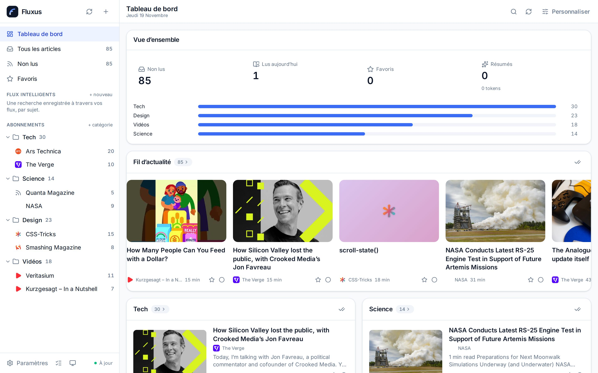
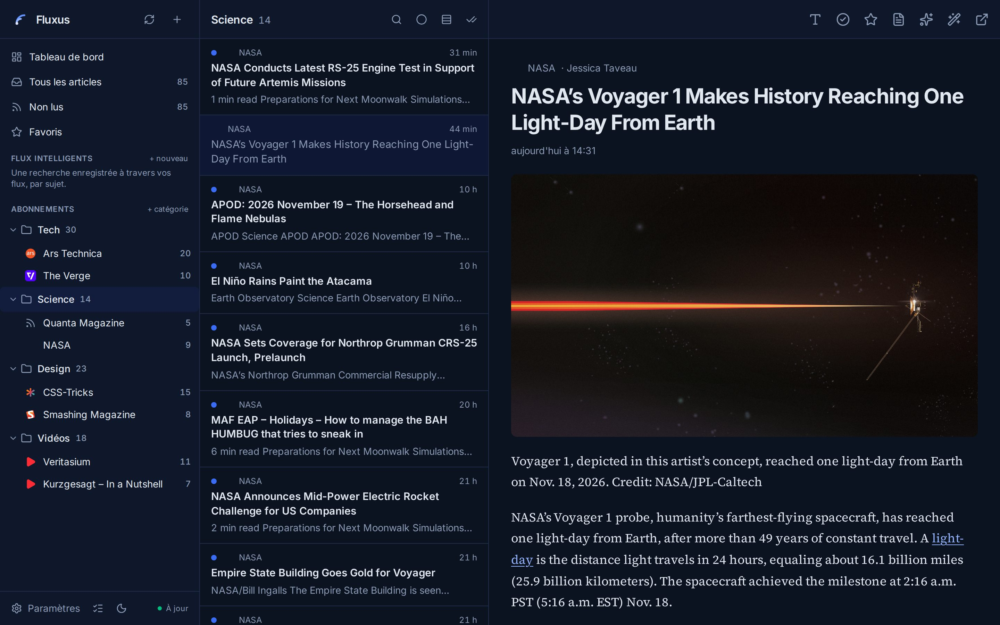

# Fluxus

A self-hosted RSS reader for one person and their devices. It brings together what classic open
source readers don't offer in one place:

- **Full articles** fetched from the site (HTTP, with a headless Chromium fallback for JavaScript sites).
- **On-demand LLM summaries**, streamed, never triggered without you (Anthropic or any OpenAI-compatible API).
- **YouTube video summaries** from subtitles, with clickable timestamped chapters.
- **Smart feeds**: saved topic searches across all your feeds, with capped automatic summaries.
- **Dashboard** of configurable widgets, shared between devices.
- **Offline-first** web app (installable PWA) and **Android app**, with read / starred sync.
- Folders, drag-and-drop ordering, feed discovery from a site URL, OPML import / export, full-text search, keyboard shortcuts.



The interface is in French. Four Docker containers, PostgreSQL as the only dependency, no external queue.

## Quick start

Requirements: Docker with the Compose plugin, and an HTTPS reverse proxy (Caddy, Traefik, Nginx…).

```bash
mkdir fluxus && cd fluxus
# Download docker-compose.deploy.yml and .env.example from the release page
cp .env.example .env
$EDITOR .env          # Postgres password, FLUXUS_SECRET_KEY (32+ random chars), ports
docker compose -f docker-compose.deploy.yml up -d
```

Images (`fluxus`, `fluxus-browser`, `fluxus-backup`) are published on `ghcr.io/taclab` for every
release. The app listens on `http://127.0.0.1:8000`; point your reverse proxy at it, open it, and
create your password. Then add feeds with **+** and set an LLM API key in *Paramètres → Résumés*.

The Android APK is attached to each [GitHub release](../../releases).



## Documentation

| | |
|---|---|
| [Installation & operations](docs/INSTALL.md) | install from images or sources, configuration, backups, updates, troubleshooting |
| [User guide](docs/USER-GUIDE.md) | dashboard, smart feeds, layouts, shortcuts, summaries, offline mode, migration |
| [Mobile](docs/MOBILE.md) | PWA, Android app, building and signing the APK |
| [Development](docs/DEVELOPMENT.md) | local setup, tests, CI, releases |
| [Architecture](docs/ARCHITECTURE.md) | code map and data flows |
| [Changelog](CHANGELOG.md) | release notes |

## License

[MIT](LICENSE)
